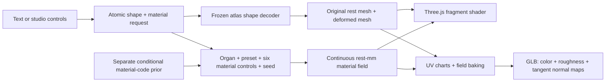

# Independent shape and material generation

The surface system now evaluates an organ-specific material at every visible fragment, rather than interpolating all detail from mesh vertex colors. Each material has its own seed and six bounded controls. The original shape decoder, shape training release, language compiler and v1 appearance implementation remain unchanged.

## What varies

All 12 organ groups have four palettes: balanced, soft, rich pigment and moist. Presets initialize the controls; the user can then adjust warmth, pigment contrast, pattern size in millimetres, surface sheen, fine detail and tissue grain independently. The pancreas and lung use authored lobular mottling, the heart uses directional grain, and other groups use soft grain. These are visual design descriptions, not histology labels. Existing ligament component labels select a paler material region.

The material seed controls spatial placement independently of the geometry seed. Fields include low-frequency pigmentation, intermediate grain, fine color detail, spatially varying roughness and shading-only microheight. Analytic microheight gradients perturb lighting normals without moving vertices. Rest-space coordinates make the surface follow shape edits. Footprint filtering suppresses detail that is smaller than a screen pixel or export texel.

## Contracts and compatibility

- `atlas_materials.py` owns the typed recipe, palettes, CPU field, analytic derivatives and exact GLSL contract. Both render paths use linear light for shading; only base-color storage uses sRGB.
- `atlas_surface_scene.py` adds an optional material-v2 recipe around the frozen `atlas_scene.py`. An absent recipe serializes exactly like v1 and uses the original realization/export path. Source and clay modes have no v2 recipe.
- `atlas_material_text.py` composes bounded surface edits with the original shape compiler. Every meaningful token must be understood, or the entire edit is rejected. Geometry-only edits preserve the current material. Switching organ initializes an appropriate organ preset; source/clay removes the authored material.
- Shape model sampling preserves the requested material. Material model sampling preserves the requested shape, organ and preset. The Studio composes the latest shape and surface edits into one debounced live preview. Surface-only edits verify the displayed geometry hash; combined edits explicitly realize both changes. Older responses cannot replace newer edits, and export uses only the last successful displayed recipe. See [editor variation behavior](ATLAS_EDITOR_VARIATIONS.md).
- The realized identifier binds geometry, normals, complete material recipe, resolved constants and shader identity. Export rejects a stale or altered recipe.

The v2 adapter explicitly repairs missing display normals on referenced vertices using incident geometric faces, preserving every valid normal and all positions/triangles. The source audit found 28 affected vertices in each brain and 67 in the male heart. Exact cancellation uses a documented largest-incident-face shading fallback; this does not repair source topology or establish anatomical validity. Every affected index and the before/after normal hashes are recorded. The original v1 normal policy remains unchanged.

Examples: `liver slightly wider and wetter`, `rich texture with wetness 0.7`, `mottle scale 8 mm`, `texture seed 913`, `less mottled`. Relative appearance edits use fixed documented design increments; a request outside a control bound is rejected, not silently clipped.

## Portable PBR export

The material-v2 exporter generates UV charts with xatlas, samples the same rest-space field at texel centres, and embeds three PNG maps in the GLB: sRGB base color, linear metallic/roughness (G roughness, B zero), and linear tangent-space normals. Clearcoat settings use `KHR_materials_clearcoat`. Tangents are explicit; the exporter accounts for the deformed surface metric when converting rest-space height gradients to tangent normals.

UV chart seams and tangent-handedness seams may duplicate vertices. Triangle locations and winding remain unchanged. Eight requested texels of chart padding and nearest-surface gutter extension reduce filtering seams. Base and clearcoat layers share the baked normal map. Each export records map hashes, texel coverage, triangles without a texel centre and actual rest-mm texel footprint percentiles. Resolution defaults to 2048²; API choices are 512², 1024², 2048² and 4096². A finite-resolution bake cannot preserve unlimited subpixel detail or guarantee identical shading in every external renderer. Tiny chart coverage and mip seams remain explicit inspection targets. Bakes are serialized per process, and cached UV layouts are bounded to 96 MiB and four entries.

The atlas protocol is based on the [xatlas Python mapping contract](https://github.com/mworchel/xatlas-python). Map encodings and tangents follow the [glTF 2.0 material specification](https://registry.khronos.org/glTF/specs/2.0/glTF-2.0.html). The editor uses [Three.js physically based surface shading](https://threejs.org/docs/pages/MeshStandardMaterial.html).

Collapsed automatic UV charts receive explicit padded face charts in a reserved strip, preserving source triangles. A singular height-gradient frame keeps the original shading normal and omits only undefined micro-normal detail; CPU export and GPU rendering use the same coordinate-invariant relative threshold of `1e-7`, which is bound into the realized identity. Counts, affected faces and atlas footprint are reported. See [the export policy and source defects](ATLAS_MATERIAL_EXPORT.md).

## Training architecture

The new material dataset stores material recipes, independent seeds, fixed source-surface anchors and actual color/roughness/height/gradient field samples. Its train, validation and audit split unit is the complete material recipe, not individual pixels. Geometry remains in the separately pinned atlas release. This avoids retraining geometry to change texture variety and avoids leaking samples from one material into several splits.

The material model predicts bounded appearance controls conditioned on organ, preset and measured field summaries. A compact neural model must beat mean, nearest-condition and ridge alternatives on validation before it is selected. Selection freezes before audit. Unconditioned generation bootstraps authored training controls with an independent spatial seed; conditional output is a proposal whose actual field statistics are measured and returned. Neither constitutes a measured human population prior.

The local API exposes `/api/atlas/sample-material`; missing or incompatible model artifacts produce an explicit error. The model and decoder are hash-bound, and the artifact uses NumPy arrays without pickle. See the material training guide and model card for the actual selected method, metrics and Colab run.

## Evidence boundary and next architecture stage

This release expands a controllable procedural design space. It does not establish patient variability, tissue optical properties, vessel topology, mechanical properties, disease appearance or clinical realism. The source meshes also have variable detail and some are display assemblies rather than closed simulation domains. A PBR shader alone does not validate anatomy or tissue mechanics.

For measured appearance learning, add licensed calibrated multiview tissue photographs, illumination/color references, anatomical region masks and expert-reviewed correspondences. Preserve patient/specimen grouping across splits. Fit optical/material parameters before adding learned spatial residual textures, and evaluate under held-out lighting and unseen specimens. A residual decoder should remain conditional on organ/region and rest coordinates, retain independent style seeds, and pass geometry-invariance, color/roughness bounds, multiview consistency and human review gates. Mechanical simulation should use a separately validated volumetric material model rather than inferring stiffness from surface color.
