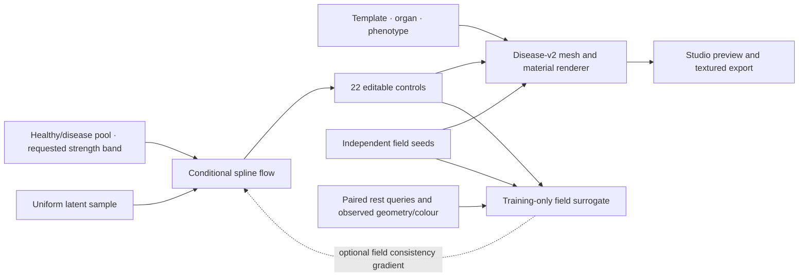

# Joint anatomy flow v2

V2 changes the generative distribution, not merely the network width. It uses a
conditional normalizing flow built from monotone rational-quadratic spline
couplings. This can represent bounded, correlated and multimodal control
populations that a single Gaussian latent prior with a small decoder may fit
poorly. The spline method and analytic inverse follow
[Durkan et al., Neural Spline Flows, NeurIPS 2019](https://arxiv.org/abs/1906.04032).
Our implementation and its NumPy deployment are local, explicitly versioned code.

The generated object still uses an editable, source-bound anatomical recipe:
seven global shape controls, six continuous material controls, and nine disease
controls. The full source mesh and continuous appearance renderer determine
output resolution. V2 is not an unrestricted neural mesh generator, a trained
biomechanical simulator, or a model of measured clinical disease prevalence.

## Conditional bounded density

The default density context pools all templates and disease profiles into healthy
or diseased control populations. Template, organ and profile embeddings are
optional residual context, multiplied by `context_gain` (default zero). This
reflects the actual authored sampler: it establishes common bounded control
support and two weak shape/material correlations, not separate patient
populations for each profile. The strength bands are handled by an invertible
coordinate map, rather than allowing redundant band embeddings to memorize
small per-band subsets. Independent random material/disease field phases do
not carry anatomical information, so they are deliberately excluded from control
density conditioning. Their exact eight seed bytes still condition the query
surrogate and the renderer. Every spline maps `[-1,1]` to `[-1,1]`, has positive derivatives, and has an
analytic inverse. Alternating complementary masks mix all 22 controls; residual
FiLM conditioners allow nonlinear cross-modal dependencies. The base distribution
is uniform on the bounded cube, rather than a Gaussian subsequently clipped into
it. Sampling uses the exact learned inverse.

The default architecture has six coupling layers, eight bins, two residual blocks
per conditioner, hidden width 96, factor embeddings of width 16, and 0.1 conditioner
dropout during training. Inference is deterministic with dropout disabled. Capacity alone
is not evidence of realism: validation reports compare density and diversity with
a truncated diagonal Gaussian and a bounded uniform baseline.

Disease design strength is explicit:

| Band | Requested design strength interval |
| --- | --- |
| Mild | 0.10–0.35 |
| Moderate | 0.35–0.70 |
| Severe | 0.70–1.00 |

These are authored visual strengths, not clinical stages. An invertible coordinate
map ensures samples remain in the requested band. Baseline has no disease object.
The renderer scales that request by the source mesh's numerically checked deformation
capacity and records any additional precision reduction. Its effective geometric
strength can therefore be smaller; the requested label is not a claim about the
result's clinical severity.
`auto` chooses uniformly between supported authored disease bands; this is not a
learned prevalence estimate.

The disease-count variable has eight integer outcomes. Training uses uniform
within-bin dequantization; deployment uses the corresponding hard inverse
quantization. Nine unused healthy-baseline disease coordinates receive independent
uniform nuisance values during density training and are masked at deployment.
They are not fitted as degenerate continuous Gaussian observations. Density
reports remove the nine nuisance entropy terms, include the severity Jacobian and
count-bin correction, and identify the result as a mixed-variable dequantization
bound per active dimension.

## Paired geometry and colour queries

Every observation names its actual rest-space query coordinate and material
region. Anchors can differ between rows and include lesion-focused coverage.
The model does not flatten different anchors into falsely corresponding targets.
Full 512-point records remain in the dataset; training samples a small query subset
on CPU and transfers only the selected batch to the GPU.

A separate query network learns deformed normalized coordinates, linear RGB and
roughness from controls, factor context, field seeds, rest coordinates and material
region. It is selected on fixed validation rows and fixed query indices, then frozen.
Validation preserves the training random state so interruption recovery remains exact. An optional distribution
loss evaluates sampled flow controls through this frozen network and compares
query displacement/colour moments within exact condition/severity groups.
When enabled, gradients reach the same inverse flow used for deployment. Exact
likelihood remains the primary objective. The default `field_weight` is zero after
the representative pilot ablation found no held-out density benefit from 0.025.
The trained query network therefore serves as a measured renderer-approximation
diagnostic in the default run; it is not claimed as additional deployed geometry
capacity or a source of training gradients that are disabled.

Including seed bytes makes the inputs complete, but does not make a pseudorandom
texture field smooth or easy to learn. Held-out geometry, colour and roughness
errors are therefore reported against a condition-mean field baseline. The proxy
is not represented as an exact renderer; independent complete-mesh checks remain
required. The pilot ablation is retained at
`artifacts/joint-v2/model-validation/pilot-field-ablation.json`. Both initial
profile-conditioned pilot models underfit the bounded uniform baseline; neither
is quality-approved. The larger release is evaluated separately with pooled
density context, including the real identity checkpoint in model selection.

## A100 execution and interruption recovery

The default run uses 4,000 flow steps and 600 query-surrogate steps, with 256 controls
and 16 sampled queries per batch. BF16 autocast is limited to capable CUDA hardware;
spline knot calculations, positive derivatives, log determinants and quadratic
inverse arithmetic remain float32. CPU and unsupported CUDA hardware use float32.
Final Torch-to-NumPy parity is checked outside autocast before export.

`checkpoint.pt` is written atomically and contains current and best model states,
optimizer/scheduler state, NumPy/Torch/CUDA random states, and a hash binding the
configuration, datasets, decoder, trainer and execution precision. Loading uses
`torch.load(..., weights_only=True)`. An interrupted run resumes the recorded
phase and step; incompatible data, code or configuration is rejected. Regression
coverage simulates disconnection after a real optimizer checkpoint and confirms
bit-identical final parameters against uninterrupted CPU training. Final artifacts
are staged and verified together; `model.npz` is published atomically after its
metadata and training report. A disconnect between sidecar publication and model
commit resumes the saved checkpoint. Both optimizer-stage and finalization-stage
interruptions have regression coverage.

The importer receives a safe NumPy model, metadata and source/data checksums. It
has no need to deserialize a training checkpoint. Full releases require at least
4,000 flow and 200 surrogate steps; short diagnostics remain explicitly labelled
`smoke` and cannot be passed off as full weights. The exact untrained identity
flow participates in validation selection. Full export additionally requires a
trained checkpoint with validation and independent audit NLL each at least 0.002
per active control better than the uniform identity. Audit results never select
a checkpoint. This gate tests fit to the authored control distribution; it does
not establish clinical realism.

## Evidence boundaries

The anatomical meshes are source-bound references; the expanded diseases and
appearance fields are authored external phenotypes. More generated examples
improve coverage of this renderer's design space. They do not constitute new
patients or calibrated optical measurements. Unpaired clinical photographs and
segmentation masks are valuable references but must not be presented as paired
mesh/texture ground truth.

The architecture regression deliberately uses a bounded correlated bimodal
numerical distribution. It achieved validation negative log likelihood 0.124 versus
0.491 for a truncated diagonal Gaussian (audit 0.125 versus 0.484), with NumPy/Torch
coordinate discrepancy below 3e-6. This demonstrates distributional capacity and
numerical correctness only. The receipt is
`artifacts/joint-v2/model-validation/spline-flow-density-regression.json`; it is
not an anatomical or clinical accuracy benchmark.
