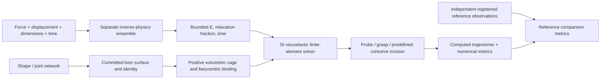

# Liver physics learning and experiment lab

Implemented 2026-10-07. This is a working numerical research prototype. Human-liver surgical realism has **not** been established.

Select a liver in Atlas, generate a reference or learned variation, then open **Physics lab**. The lab uses the **displayed, committed organ**, including its learned geometry controls. **Hands-on** opens an interactive room where pointer tools manipulate the organ while physics advances. **Recorded experiments** runs indentation, grasp/release, or scripted incision with the separate finite-element solver. Recorded playback shows computed states; playback FPS is not simulation throughput. Force curves, deformation, recovery, volume error, Jacobians, solver failures and runtime are retained in the downloadable experiment JSON.

The [2026-10-07 v2 release report](../benchmarks/results/liver-physics-v2-2026-10-07/README.md) records the earlier continuum/AI release results: 75 Python checks, 111 frontend unit checks, 18 browser scenarios (10 mocked and eight real), type checking and build pass. It links the literature review, sampled video audit, final recording and preserved failed iterations. Older protocol and interactive benchmarks below are retained with their original solver and source identities.

## Current contact and measurement upgrade

The [contact upgrade report](../benchmarks/results/liver-contact-upgrade-2026-10-07/README.md) records the current room implementation and fresh verification. Closest sphere–triangle augmented contact replaces the room's sampled penalty default; load-dependent floor friction replaces its gravity-only approximation. Probe-center containment, motion limits, contact overlap, reactions and signed work are exposed. The geometric overlap improvement does not establish force convergence: the female force/work half-timestep comparisons still exceed the proposed 5% gate.

The independent cage audit additionally finds artificial interior sheets and non-manifold boundary edges after near-coplanar Delaunay cells were removed. Extracted female/male boundary area is 31.98%/30.20% above the convex hull. This is an inherited contact-domain defect, not corrected or certified by the new overlap metric; external-surface validity and mesh repair remain open.

Use **Fit liver** or **F** to recover the camera around the deformed liver while preserving an engaged tool. **Record motion**, **Stop recording**, and **Download motion JSON** export source/material provenance, deformed cage nodes, real sample timestamps, tool/camera states and numerical measurements. Sampling is capped at 30 Hz and finite storage; fast impacts may occur between samples. Punch events additionally retain actual authored impulse and kinetic-energy change. Reset/drop are separate segments, and contact lifecycle changes are excluded from probe-motion work. These measurements support independent audit, not automatic material identification from video.

The optional [calibration robustness study](PHYSICS_AI_ROBUSTNESS.md) missed its frozen valid-calibration acceptance gate (64.5% versus 65%) and remains analysis-only, off by default. The trained v2 parameter network and default application checks are unchanged.

## The separate network

The physics model is independent of the shape, color, disease and language models. The default **v2** estimator predicts instantaneous Young modulus `young_pa`, relaxation fraction `relaxation_fraction`, and uniaxial relaxation time `relaxation_time_s`. Three MLPs (165 → 160 → 96 → 3) propose bounded parameters; a robust physical fit refines all three against the measured history. Separate synthetic calibration produces nominal 90% marginal intervals, displayed with the applied parameters. Residual, excitation, parameter support and sensitivity checks govern application.

The [v2 report](PHYSICS_LEARNING_V2.md) records training on 12,000 synthetic specimens and final testing on 640 IID plus 320 held-out parameter-region specimens. IID median E/g/τ errors are 1.43%/2.17%/5.30%; uncertainty tails remain wide. Conventional bounded fitting attains essentially the same final accuracy, and the neural warm start does not show a median latency benefit. These are declared synthetic tests, not patient accuracy.

V2 accepts **16–257 samples over 1–12 seconds**, with .5–5% peak positive uniaxial strain, zero initial strain and tared force. Ramp/hold/release, triangular and smooth cyclic histories are supported within the documented training regime. The API returns diagnostics for a weak or mismatched calibration but refuses to apply rejected estimates to either the room or recorded experiments. V1 remains available through an explicit `VISCERA_PHYSICS_MODEL` override.

Its inputs are **calibrated force and displacement from a specified small-strain uniaxial experiment**, with reference area, reference length, timestamps and provenance. Shape and surface color cannot identify these material parameters. Poisson ratio, density, contact penalty and fracture-work density remain explicit assumptions; they are not learned by this experiment.



The delivered model is trained on **synthetic** standard-linear-solid (SLS) experiments, not on measured human liver. The UI defaults to an explicitly labeled synthetic demonstration observation. A user-supplied calibration observation can be sent with `/api/physics/run`; its fitted parameters and provenance remain attached to the run. This does not certify the observation's calibration or establish its transfer to surgery.

### Historical v1 contract and frozen baseline

The following contract and results describe the preserved **v1** artifact, not the current v2 default. V1 is intentionally narrow:

- 81 samples at `times_s = 0, 0.075, …, 6`.
- Zero initial force/strain; 2.5% axial strain ramp over 0.6 s, hold to 3.6 s, unload to 4.2 s, recover to 6 s.
- `force_n`, `displacement_mm`, positive `reference_length_mm` and `reference_area_mm2`, and a provenance string.
- Uniaxial stress is force divided by original area; strain is displacement divided by original length. An arbitrary organ-grasp force trace cannot be relabeled as this test.
- Unsupported excitation, missing units, nonfinite values, a failed model release or a bad fit are rejected before parameter application. `/infer` retains a bad-fit diagnostic but `/run` does not promote it.

The holdout contains 1,024 independently sampled synthetic parameter specimens. Every time point of each specimen stays in its split. Training uses 6,144 specimens; validation uses 768. Stress noise is Gaussian with sigma 0.3% of each trace's peak; geometry and strain are exact. The initial raw neural result was retained as a development artifact; final evaluation uses a new frozen seed. These splits do not represent real patient generalization.

| Final synthetic holdout metric | Result |
|---|---:|
| Median absolute relative Young-modulus error | 0.56% |
| Median absolute relative relaxation-fraction error | 1.12% |
| Median absolute relative relaxation-time error | 1.86% |
| 95th percentile modulus / fraction / time error | 3.14% / 12.12% / 11.74% |
| Median stress RMSE / peak true stress | 0.149% |
| 95th percentile stress RMSE / peak true stress | 0.738% |
| Mean-parameter baseline median stress error | 53.10% |

The exact report is [`artifacts/physics/liver-network-v1/evaluation.json`](../artifacts/physics/liver-network-v1/evaluation.json). Ensemble disagreement is reported separately and is **not a calibrated confidence interval**. Same-family synthetic tests do not measure model-form error, instrument calibration error, or cross-species transfer.

## How parameters reach the mesh

`liver_physics.py` builds an SI tetrahedral volume around the exact source vertices. The input scene identity and geometry hash are preserved; it does not substitute the old procedural liver. Barycentric material coordinates bind every original surface vertex to a tetrahedron. Rest reconstruction and arbitrary affine motion are tested. All tets must have positive rest volume, and accepted deformed states must retain positive Jacobians.

The volume is a **convex enclosure**, not a conforming anatomical tissue domain. Its reported volume excess relative to the source convex hull quantifies one geometric approximation; it does not measure the missing concavities, vessel trees, capsule or internal structures. The displayed anatomical surface can be more detailed than the mechanically resolved volume. This is a material limitation of the current solver, not solved by high-resolution rendering.

The equilibrium branch is rest-stable polynomial Neo-Hookean; an objective deviatoric Green-strain Maxwell state supplies genuine stress relaxation during a hold. Backward Euler and separate numerical damping stabilize integration. Learned material relaxation is not replaced by velocity damping.

For constant bulk modulus `K`, the network's **uniaxial** parameters map into shear material parameters:

```
mu0 = E0 / (2 * (1 + nu0))
K = E0 / (3 * (1 - 2 * nu0))
Einf = E0 * (1 - gE)
muinf = 3 * K * Einf / (9 * K - Einf)
tau_mu = tau_E * (3 * K + muinf) / (3 * K + mu0)
```

The actual 3D constitutive test solves traction-free lateral response and verifies its small-strain uniaxial relaxation against the SLS analytic response. This mapping does not validate the large-strain constitutive choice.

## Surgical-tool protocols

| Protocol | Implemented behavior | Scope |
|---|---|---|
| Indentation | Area-weighted surface contact with a sphere, loading, hold, unloading and recovery | Barycentric triangle quadrature; penalty overlap and contact resolution remain measured approximations |
| Grasp/release | Distributed compliant attachment, ramp, hold and release | Rendered jaws are visual; no resolved jaw pressure, friction or slip law |
| Incision | Duplicated nodes on a premeshed seam, irreversible cohesive-bond release, retraction/opening | Prescribed plane and blade sequence; no arbitrary remeshing or fracture-path prediction |

The incision changes mechanical connectivity. It is not a cosmetic deleted-triangle effect. The incision display uses the cut simulation boundary so the original intact surface cannot bridge a mechanically open seam. The supplied fracture energy defines an **assumed work budget**. Reported interval blade force is derived from that budget and the blade advance; its energy equality is algebraic, not an independently predicted surgical cutting force. Retraction and cohesive stored-energy release are not claimed to complete a thermodynamic fracture balance.

The recorded finite-element protocols do not implement gravity/prestress, measured attachments, capsule, vessels, self-contact, friction, blood flow or cutting safety assessment. Linear tetrahedral locking and spatial convergence remain concerns. Finite-state checks and low volume drift do not prove physical fidelity. The separate interactive room described below includes gravity and an authored floor.

Contact was revised after the first benchmark showed sparse vertex contact losing its load between nodes. The replacement integrates fixed reference-area samples over boundary triangles and scatters forces barycentrically. A conservative displacement-bound filter accelerates it without dropping active samples. Independent tests verify tool/nodal force balance, energy gradients, continuous loading while a sphere crosses triangle edges, and agreement with an analytic flat-surface force. The default probe penalty is `indentation_stiffness_n_m = 20000`; grasp/cohesive attachment retains its separate `contact_stiffness_n_m = 300`. Neither is a learned liver property. Maximum penetration, active contact samples and lost-contact frames are recorded; this is not continuous collision detection or exact nonpenetrating contact.

## Assessment and evidence

Numerical metrics and real-reference errors are separate:

- Numerical: minimum deformation Jacobian, inverted elements, volume change, stationarity residual, rejected/unconverged steps, surface-binding error, peak/residual displacement, timing and seam connectivity.
- Reference force: vector RMSE in N, time-weighted NRMSE divided by **reference RMS force**, vector impulse error and signed work in J.
- Reference video tracks: corresponding landmarks in calibrated mm, or explicitly pixel-only errors; RMSE/p95 and visible coverage are retained. Missing/occluded tracks are not treated as zero error.
- Silhouettes: same-camera binary-mask IoU at shared timestamps.
- Time behavior: declared hold relaxation and observed-surface recovery, when the necessary reference windows and landmarks exist.
- Alignment: common physical-time overlap with stated interpolation; no time shifting or time warping to improve the score. Coordinate/camera registration must be supplied or remains an unverified assumption.

`physics_assessment.assess_experiment(simulation, reference=None)` accepts the lab result directly. Missing references return `NOT_RUN`; even computed errors never automatically establish physical validity. It supports extracted observations, **not automatic raw-video reconstruction**. A video alone does not provide calibrated force, absolute stiffness or a known rest volume.

The learning fit uses **peak stress** normalization; the professional reference-comparison force NRMSE uses **RMS force** normalization. Reports name these different denominators explicitly. The runtime tool force is reaction on the tool; reference work requires a consistent, work-conjugate force/displacement convention. The lab's work-on-tissue sign is the opposite of reaction-force work.

Reproducible trajectories, diagnostics and refinement comparisons are in [`benchmarks/results/liver-physics-2026-10-07`](../benchmarks/results/liver-physics-2026-10-07). Refinement observations are diagnostics, not an automatic mesh-convergence certificate. Browser QA includes actual 3D frame changes, protocol switching, source preservation, downloads, cancellation and mobile behavior.

### Final measured results

The isolated benchmark uses an actual joint-network liver sample (seed 123), its 15,136 source vertices, and the separate physics network's synthetic demonstration fit. The main intact volume has 94 nodes and 311 tetrahedra; its convex enclosure exceeds the source convex-hull volume by 4.74%. All five main/refinement runs had zero inverted elements, rejected steps, unconverged steps or accepted inversion-guard activations.

| 6 mm tool protocol | Minimum Jacobian | Maximum volume error | Peak tool force | Mean solve time / step |
|---|---:|---:|---:|---:|
| Indentation | 0.829 | 0.086% | 0.537 N | 154 ms |
| Grasp/release | 0.963 | 0.111% | 0.686 N | 92 ms |
| Scripted incision/retraction | 0.981 | 0.048% | 9.987 N, assumed fracture-work budget | 179 ms |

Indentation maintained contact throughout loading/hold, with maximum penalty penetration of 0.479 mm. Grasping recovered 89.8% of its peak cage displacement by the end of the four-second experiment. Incision severed 12 of 12 predefined bonds and opened the seam by 6.03 mm. These are computed responses, not agreement with measured liver behavior. The solver does not currently provide real-time surgical or haptic feedback.

An important unresolved behavior appears in the learned male-liver benchmark: 6 mm indentation produces 24.9 mm peak motion elsewhere in the cage and 9.83 mm residual motion at four seconds. The stiff 12 mm extreme case reaches 41.9 mm peak cage motion. Numerical checks pass, but those large motions remain **unvalidated consequences of the coarse domain and authored supports**. They require calibrated attachments, a conforming tissue domain and independent motion measurements before any surgical-realism claim.

Doubling grasp time resolution changed the force trajectory by 1.84% RMS-normalized error and corresponding source-surface points by 0.031 mm RMSE. Increasing spatial resolution changed them by 2.16% and 0.163 mm respectively. Correspondences use the same 128 source material points, not measured anatomical landmarks. This checks sensitivity over one refinement level; it does not establish convergence for every tool or geometry. The separate soft-grasp and stiff-indentation extreme-control runs also passed numerical checks; the latter needed seven solver retries.

Verification completed with **107 Python tests passed, one existing opt-in archive integration test skipped; 85 frontend unit tests; seven mocked browser tests; four actual browser experiments; TypeScript and production build passed**. Python results are retained in [`python-tests.xml`](../benchmarks/results/liver-physics-2026-10-07/python-tests.xml). Browser verification used a source-identical temporary mirror because cloud-backed workspace dependency files were unreadable; exact environments and source hashes are in [`browser/verification.json`](../benchmarks/results/liver-physics-2026-10-07/browser/verification.json).

The [recorded browser demonstration](../benchmarks/results/liver-physics-2026-10-07/browser/liver-physics-lab.mp4) shows indentation, grasping, cutting, plots and calibration upload. That browser run uses a different displayed female-liver scene, so its measurements differ from the isolated learned male-liver benchmark. It is functional evidence, not a comparison against surgical footage. The [diagnostic plot](../benchmarks/results/liver-physics-2026-10-07/diagnostics.png), [complete benchmark report](../benchmarks/results/liver-physics-2026-10-07/report.json) and [extreme-control report](../benchmarks/results/liver-physics-2026-10-07/extremes.json) preserve the numerical evidence.

## Hands-on room

The **Hands-on** tab prepares the committed liver's volumetric cage and original-surface binding through `POST /api/physics/playground`. The browser then advances its own local simulation. The room offers **Grab**, **Push**, and **Punch**; **Orbit** changes the camera. Primary pointer or touch input operates the selected tissue tool. Right dragging rotates the view. **Gravity**, **Lift & drop**, **Pause physics**, **Reset liver**, and **Reset room view** control the room without regenerating the selected anatomy. Material edits take effect through **Apply material**.

The default browser now uses the **same finite-strain stable Neo-Hookean/Green-Maxwell constitutive law as the recorded Python FEM**. A vertex block descent solve minimizes its implicit-Euler incremental potential with tool and floor contact. Learned E/g/τ therefore have verified continuum meanings instead of a cage-dependent edge stiffness calibration. Objectivity, small-strain moduli, relaxation and 48 Python/TypeScript material-history states are tested. Four local sweeps remain an approximate integration; material-law parity does not establish trajectory convergence.

The old edge/volume XPBD implementation remains available through `materialModel: "legacy"` for comparison. Its edge energy also resists dilation and depends on mesh orientation, so it does not reproduce the recorded continuum law. The [mechanics review](research/LIVER_MECHANICS_REVIEW_2026-10-07.md) explains the selected VBD formulation and rejected XPBD continuum candidates; [frozen numerical comparisons](../benchmarks/results/liver-continuum-2026-10-07/) retain their evidence.

Gravity acts on a free organ above an authored rigid floor. This room is a manipulation sandbox, not a supported or prestressed liver in surgery. Tissue influence radius and strength describe interaction controls, not calibrated surgical jaw geometry or instrument force. The separate probe radius sets the visible ball and spherical contact size. The playground has no arbitrary live cutting, organ self-contact, anatomical supports, capsule, vessel mechanics, or physical validation. The recorded incision experiment remains available in **Recorded experiments**.

The default continuum uses fixed 1/120 s steps and four vertex sweeps, up to six steps per animation callback. Legacy uses 1/240 s and ten constraint sweeps, up to twelve steps. The browser reports discarded catch-up time and rejected simulation time separately. The displayed render rate is separate from simulation speed. Floor friction, central pairwise damping, weak air drag, tool target speed limits, and a velocity cap are authored numerical or room assumptions. They are not learned liver viscosity or calibrated instrument contact.

The continuum bounds each vertex update to maintain `J > 0.1`, observes the floor active set and backtracks against incremental energy. Volume-limit activations, line-search backtracks, rejected updates and last-sweep correction are retained. The last correction is a progress diagnostic, not an equilibrium residual. The default does not use the old volume projections.

In the preserved **legacy** implementation, an explicit minimum-volume safeguard targets `J = 0.4`; additional floor-compatible projection sweeps seek `J ≥ 0.36`, with a maximum of 64 sweeps. The final transactional check requires `J > 0.08` and floor-admissible, finite positions. Limited and rejected steps, minimum-volume corrections, and dropped time remain visible. These safeguards can change the response and must be included in any later material validation. They are not evidence that severely compressed tissue follows the learned constitutive law.

Frozen **legacy** interactive evidence is kept separately in [`benchmarks/results/liver-playground-2026-10-07`](../benchmarks/results/liver-playground-2026-10-07). Browser checks compare actual nodal positions while verifying that the camera stays fixed, recompute tetrahedral Jacobians from those positions, and record material provenance, gravity/floor behavior, pointer and touch input, and repeated strong interactions. These checks establish behavior and numerical limits; they do not compare the motion against real liver measurements.

The displayed **height change** includes rigid rotation as the organ falls onto its side. It is not a tissue strain measure. The displayed edge-length strain and the test report's RMS change in pairwise node distances exclude both rigid translation and rotation. They distinguish actual deformation from moving or turning an otherwise rigid organ.

The earlier **legacy** implementation had an actual-cage floor-impact failure: the female organ retained positive Jacobians while its simulation clock stopped after about 0.16 s. This is why finite coordinates alone are insufficient. That failed development evidence is preserved in [`development-floor-freeze`](../benchmarks/results/liver-playground-2026-10-07/development-floor-freeze). The floor-compatible adaptive safeguard was then tested against the same sequence, including a 75 mm drop after freefall and reset. Both cages completed all six requested simulation seconds with zero rejected or limited steps and zero measured floor penetration. The final minimum Jacobians were 0.416 and 0.802, respectively. The safeguard made 43,287 and 10,669 volume corrections during those runs; this active stabilization is part of the approximation, not an independently validated tissue effect.

The historical legacy [manual material extremes](../benchmarks/results/liver-playground-2026-10-07/extremes.json) also retain a material limitation: `E=500 Pa`, `ν=0.2`, and relaxation fraction `0.75` produced approximately 45% volume loss and 1.63 million safeguard projections. That run advanced without rejected steps, but its response is strongly influenced by the safeguard and is not a nearly incompressible liver model. Numerical stability is not enough to accept every slider combination as plausible anatomy.

The final [live-browser report](../benchmarks/results/liver-playground-2026-10-07/browser/verification.json) covers three passing scenarios with the real API: desktop tools and room controls; manual material application and strong interaction; and mobile touch. The corrected Push gesture changes penetration along the initial surface normal when dragged vertically, moves laterally when dragged horizontally, and keeps the sphere above the floor. A sustained push on the settled female liver produced 3.71 mm RMS change in pairwise node distances, with zero floor penetration or rejected steps. This is actual deformation, not camera motion. Contact remains compliant and permits measurable probe overlap; its sampled values are retained in the report.

During a separate five-second gravity interval, the browser advanced 4.87 simulation seconds over 5.01 wall-clock seconds, approximately 0.97× real time on the recorded machine. This interval estimate uses 5 Hz diagnostics and is not a device-independent throughput guarantee. The [recording](../benchmarks/results/liver-playground-2026-10-07/browser/liver-playground.mp4) and [supported-push screenshot](../benchmarks/results/liver-playground-2026-10-07/browser/push-against-floor.png) show the actual interactions. The extension's checks comprise 43 targeted Python/API tests, 96 frontend unit tests, nine mocked browser tests, and three live browser tests, plus type checking and production build. Their exact sources and environments are recorded beside the artifacts; the older finite-element benchmark remains unchanged.

## Visible laparoscopic instruments

The hands-on room displays an articulated fenestrated grasper for **Grab** and a metallic blunt palpator for **Push** and **Punch**. The instrument is visible before contact and follows pointer hover. Holding a grab closes the jaws; release, pause and tool changes clear the contact and reopen them. **Orbit** hides the instrument while moving the camera. Touch uses the same contact and articulation states.

The grasper tip follows the solver's actual bounded grab handle. Its displayed jaws are an interaction cue: tissue is attached through a compliant barycentric patch, not resolved jaw contact or friction. The palpator ball has a separate **Probe radius**, 6–12 mm, and its rendered sphere center and radius match the solver's actual moving sphere. The visible distal tip is one radius from that center along the shaft axis. Following the actual contact state prevents the display jumping ahead of the solver's speed-limited target. **Punch** remains an impulse, even though it now has a visible instrument animation.

The shaft, handles and individual jaw surfaces do not collide with tissue or the room; surgical access, jaw squeezing, instrument force calibration and live cutting are not implemented. These are laparoscopic-style visuals coupled to the existing approximate grip and sphere mechanics, not a validated instrument model.

The separate [instrument evidence](../benchmarks/results/liver-laparoscopic-tools-2026-10-07/README.md) retains browser screenshots, video, contact alignment checks and actual mouse/touch deformation. It does not replace the earlier 45 mm sphere benchmark, whose recorded contact size is intentionally preserved. The current visible palpator is evaluated with its smaller 12 mm maximum physical radius. Six live browser checks passed, including the original room regressions and three instrument cases. A supported probe gesture produced 1.78 mm RMS pair-distance change, with 0.906 mm maximum compliant overlap, zero floor penetration and no rejected steps. The [recording](../benchmarks/results/liver-laparoscopic-tools-2026-10-07/browser/laparoscopic-tools.mp4) shows the full desktop instrument; mobile keeps the contact tip and shaft visible while the remote handle can extend beyond the close-up viewport.

## Run and reproduce

From `viscera/`:

```sh
PYTHONPATH=py:. uv run --extra train python scripts/train_liver_physics_v2.py --output artifacts/physics/liver-network-v2 --v1 artifacts/physics/liver-network-v1
PYTHONPATH=py:. uv run --extra train pytest tests/python/test_physics_learning_v2.py tests/python/test_physics_v2_routing.py tests/python/test_physics_learning.py tests/python/test_liver_physics.py tests/python/test_physics_assessment.py tests/python/test_physics_api.py
PYTHONPATH=py:. uv run --extra train uvicorn services.api.app:app --host 127.0.0.1 --port 8000
```

Start the studio separately with `corepack pnpm studio`, then open its displayed localhost URL. Physics inference and simulation use NumPy/SciPy; Torch is needed only for retraining. Models are JSON weights with a SHA-256 manifest, avoiding pickle execution. The independent physics status is available at `/api/physics/status` and in Trained models.

To benchmark a saved Atlas API generation response:

```sh
PYTHONPATH=py:. uv run --extra train python scripts/benchmark_liver_physics.py --scene generated-liver.json
```

The benchmark runs three tools and additional time/mesh refinement cases. It preserves the exact generated scene and its learned model provenance. API routes are `GET /status`, `GET /demo-observation`, `POST /infer`, `POST /run`, `POST /playground`, and `POST /assess`, all under `/api/physics`. Open `/docs` for typed request examples. A single-process solve lock protects server-side preparation and experiments. The prepared room advances locally in the browser.

With the API and Studio already running, test the live room with:

```sh
VISCERA_PHYSICS_STUDIO_URL=http://127.0.0.1:5198 corepack pnpm exec playwright test --config playwright.physics-playground.config.ts
```

## Research decision and next acceptance gate

The [implementation evidence review](../research-report/Liver%20Physics%20Implementation%20Evidence%202026-10-07.md) distinguishes living human, cadaver and animal evidence and compares current differentiable simulation, neural constitutive modeling and cutting work. It supports a bounded inverse estimator plus explicit material history as a practical first implementation; it does not establish a universal “best” liver law.

To move from this working prototype to credible surgical realism, acquire registered liver force/depth/geometry experiments with specimen-independent splits; construct a conforming capsule/parenchyma/vessel domain; perform spatial/time/contact convergence; fit regional nonlinear viscoelastic response; identify attachments and friction; calibrate irreversible fracture against real incision data; then evaluate force, tracked surface motion and blinded expert realism together. More synthetic samples cannot replace those measurements.

The larger roadmap is tracked in [PHYSICS_AI_V2_PLAN.md](PHYSICS_AI_V2_PLAN.md). The v2 inverse estimator is delivered; conforming anatomy, capsule, richer learned material laws and independent human-liver validation remain open. The [multi-venue method review](research/LIVER_PHYSICS_METHOD_SELECTION_2026-10-07.md) and [26-file video audit](research/LIVER_VIDEO_EVIDENCE_2026-10-07.md) record the additional research, observed motion and evidence limits.
