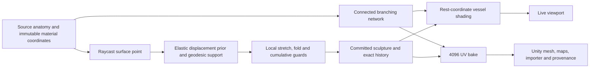

# Surface authoring and Unity 4K export

Implemented and reviewed on 7 October 2026. The Atlas workspace now supports persistent surface-point sculpture, branching vessels that follow the tissue, and a Unity package containing full-resolution PBR maps and an importer.

## Use the tools

1. Open the Atlas workspace with the existing `pnpm dev` workflow. Choose a reference and **Tissue** appearance.
2. Open **Surface** to control vessel density, visibility and calibre. **New branching pattern** changes the procedural seed. Tissue presets and finish controls still work.
3. Open **Sculpt**, choose the influence radius and resistance, and drag a surface point. Release to keep the edit. Right-drag or switch to **Orbit** to rotate the camera. Touch dragging is supported. Escape cancels a stroke; undo, redo and reset retain exact geometry.
4. Use **Unity 4K** to download the displayed shape and material. Extract the ZIP and copy `Assets/VISCERA` into the Unity project's `Assets` folder. After compilation, drag `Anatomy.visceraunity` into the scene. The importer detects Built-in, URP or HDRP; its Inspector also allows an explicit pipeline selection. Unity uses metre-scale coordinates with transform scale 1.

The package contains three 4096 × 4096 PNGs: sRGB base color, tangent normal, and a linear mask packed as metallic / occlusion / disabled detail / smoothness. Occlusion is constant one; it is not a simulated occlusion map. URP Complex Lit receives the wet clearcoat; Built-in Standard has no corresponding coat lobe. The importer preserves exported normals and tangents and configures texture sizes, color spaces and uncompressed import explicitly. Full fidelity uses substantial texture memory; platform optimization remains a separate step.

Both **Export GLB** and **Unity 4K** include the committed sculpture and the active vessel field. Unapplied controls are excluded. Material edits preserve the sculpture. Generating a different shape requires resetting the sculpture first; undoing all edits permits a new shape and invalidates stale redo snapshots.

## What changed

Vessels use surface routing, downstream-demand calibre with a cubic Murray relation, locally clustered fine branches, rounded junctions, modest tortuosity, and depth-softened color/relief. The material field stays in immutable rest coordinates, so it follows deformed triangles without detached overlay meshes. This is an authored appearance system, not a reconstruction of named physiological vessels.

The sculpt tool combines a regularized Kelvinlet displacement prior, bounded graph-geodesic support, displacement smoothing, conditional local volume compensation and backtracking geometric guards. It is a synthesis of existing methods, not a new elasticity equation. Resistance is an artistic control, not a measured Young's modulus. Fine source details remain in the rest shape because smoothing acts on displacement.

The detailed primary-source reviews compare alternatives, explain equations, separate evidence from inference, and document future work:

- [Surface vessels: growth, branching, layered optics and verification](research/SURFACE_VESSELS_2026-10-07.md)
- [Anatomy sculpting: ARAP, biharmonic weights, Kelvinlets, PD, XPBD and contact](research/ANATOMY_SCULPT_2026-10-07.md)
- [Unity 4K export: import settings, coordinate frames and material channels](research/UNITY_4K_EXPORT_2026-10-07.md)

## Verification and visual iterations

Four vessel iterations replaced root-to-tip spokes with shared branching, rounded junctions, and clustered small twigs. Real WebGL renders of liver, heart and kidney were reviewed. Independent TypeScript/Python vessel samples agree within 8.4e-17; this checks the implemented field, not physical tissue optics.

The final integrated run performed a visible 15.2 mm drag on the actual liver reference, undo, redo, vessel on/off comparison, front/back/top/oblique inspection and a Unity 4K download. No browser console or JavaScript errors occurred. The actual download took 64.454 seconds on this busy host. The archive contains 1,648 surface segments and three 4096² PNGs.

Independent package verification checked every one of the 35,606 triangles against the submitted sculpture after coordinate conversion, with maximum position error 3.70e-9 metres. Five hundred sampled baked color, smoothness and normal texels matched independently recomputed uint8 values exactly. The package was also rendered with its actual mesh and textures in a separate Three.js inspector. That is a reimport check, **not execution inside Unity**.

After the original API download, packaging was brought to the final exporter version: content-derived directory naming, attribution text and vessel-summary metadata. Mesh, texture and importer bytes were unchanged. The verification receipt records this separately.

Final frontend verification: **155 unit tests, 13 browser tests, TypeScript checking and production build passed**. Export verification: **22 targeted Python tests**, plus **8 vessel evaluator tests**, passed. Two pre-existing stale wording assertions were updated to the existing disease-panel copy and mobile control label. Browser coverage includes mouse and touch strokes, cancellation, geometry history, material preservation, reset requirements, vessel payloads and stale redo rejection. A separate screenshot comparison confirmed exact organ-pixel restoration for undo, redo and Escape.

The recording was sampled at 4, 8 and 12 seconds in addition to action-stage screenshots. These frames show surface controls, the committed deformation and the returned oblique view. The remaining long interval is primarily texture export. Review was sampled, not frame-by-frame. Back-view inspection also retains the reference's actual open surfaces rather than concealing them.

## Artifacts

- [Sculpted liver with vessels: Unity 4K package](../benchmarks/results/surface-authoring-2026-10-07/sculpted-liver-vessels-unity-4k.zip)
- [Heart: Unity 4K package](../artifacts/unity-4k-2026-10-07/viscera-heart-4k.unity.zip)
- [Reimported baked liver image](../benchmarks/results/surface-authoring-2026-10-07/unity-package-reimport.png)
- [Recorded authoring session](../benchmarks/results/surface-authoring-2026-10-07/surface-authoring.webm)
- [Browser verification](../benchmarks/results/surface-authoring-2026-10-07/browser-verification.json)
- [Independent package verification](../benchmarks/results/surface-authoring-2026-10-07/integrated-package-verification.json)
- [Independent sculpt image/topology verification](../benchmarks/results/anatomy-sculpt-2026-10-07/image-regression-and-topology.json)
- [Vessel research renders and parity evidence](../artifacts/surface-vessels-2026-10-07/)

Source, screenshots, videos, raw request/specimen, test logs, audit scripts and file hashes are retained in the linked directories. Browser tests ran from a temporary byte-copied source tree because workspace dependency reads were intermittently stalled; implementation changes remain in this repository. The local preview is a development server, not a deployment.

## Remaining boundaries

Unity Editor is unavailable on the host, so native C# import, shader compilation and Unity rendering remain **NOT_RUN**. The importer has source and contract checks, but those cannot replace a native Unity acceptance run.

The inspected liver has seven connected components and 422 boundary edges; its largest parenchyma component remains open even after coincident vertices are welded. Enclosed-volume correction is therefore disabled for that reference and the UI says “open surface.” Closed synthetic fixtures exercise volume correction. This does not establish a closed liver volume or incompressible tissue response.

Local face/stretch guards do not prove global self-intersection freedom. The tool is static surface authoring, not calibrated tissue mechanics. Vessels are procedural appearance, not anatomically validated vasculature or blood-flow simulation. Independent anatomy, optical and tissue-mechanics validation remains necessary before describing these assets as clinically realistic.
